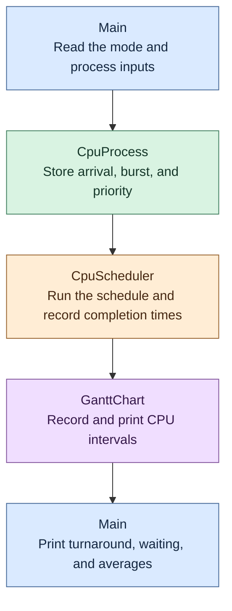

<p align="center">
  
  &nbsp;&nbsp;&nbsp;
  <a href="https://github.com/miraflowwer"></a>
  &nbsp;&nbsp;&nbsp;
  
</p>

# CPU Scheduling Simulator

Compare six CPU scheduling modes with this Java console program. Enter your own processes or generate them randomly, then use the Gantt chart and timing results to see who runs next and how long each process waits.

[Tutorial](TUTORIAL.md) · [Source guide](BRIEF.md) · [Activity PDF](CPUScheduling_Larano_Froilan.pdf)

## Run the program

Install [JDK 26](https://adoptium.net/) and [Apache Maven 3.9 or later](https://maven.apache.org/install.html). Run `java -version` and `mvn -version` to check your setup. Maven should report Java 26 or a newer JDK that can build for Java 26.

If you have access to the repository, clone it and open the project directory.

```sh
git clone https://github.com/miraflowwer/cpu-scheduler.git
cd cpu-scheduler
```

If you have a ZIP copy, extract it and open a terminal in the folder containing `pom.xml`. Then build and start the simulator.

```sh
mvn compile
java -cp target/classes com.mycompany.cpuschedulerport.Main
```

The default chart uses boxes. Add `--text-chart` after `Main` to print one interval per line. For a set of inputs you can try immediately, use the [tutorial’s three-process example](TUTORIAL.md#run-the-example).

## Learn the scheduling algorithms

### Video lessons

Select a preview or title to watch the lesson on YouTube.

<table>
  <tr>
    <td align="center" width="50%">
      <a href="https://www.youtube.com/watch?v=VSMAjMfJ6KQ"><br><strong>First Come First Serve</strong></a><br>
      <sub>Run processes in arrival order.</sub>
    </td>
    <td align="center" width="50%">
      <a href="https://www.youtube.com/watch?v=t0g9b3SJECg"><br><strong>Shortest Job First</strong></a><br>
      <sub>Choose the ready process with the shortest burst.</sub>
    </td>
  </tr>
  <tr>
    <td align="center" width="50%">
      <a href="https://www.youtube.com/watch?v=lpM14aWgl3Q"><br><strong>Shortest Remaining Time</strong></a><br>
      <sub>Work through a solved example of preemption.</sub>
    </td>
    <td align="center" width="50%">
      <a href="https://www.youtube.com/watch?v=YzBBJYfwdi8"><br><strong>Round Robin</strong></a><br>
      <sub>Give each ready process a turn with a time limit.</sub>
    </td>
  </tr>
  <tr>
    <td align="center" width="50%">
      <a href="https://www.youtube.com/watch?v=gHKSmz-W0x0"><br><strong>Priority Scheduling (Non-preemptive)</strong></a><br>
      <sub>Choose by priority when the current process finishes.</sub>
    </td>
    <td align="center" width="50%">
      <a href="https://www.youtube.com/watch?v=A860nFJ0FsA"><br><strong>Priority Scheduling (Preemptive)</strong></a><br>
      <sub>See when a higher-priority process can take over.</sub>
    </td>
  </tr>
</table>

### Read the implementations

| Resource | What to look for |
| --- | --- |
| [OSTEP scheduling chapter (PDF)](https://pages.cs.wisc.edu/~remzi/OSTEP/cpu-sched.pdf) | Worked examples of FIFO, shortest-job scheduling, and Round Robin. |
| [OSTEP Python scheduler](https://github.com/remzi-arpacidusseau/ostep-homework/blob/master/cpu-sched/scheduler.py#L51-L120) | Follow how FIFO (also called FCFS) walks the job list, SJF sorts by job length, and Round Robin moves unfinished jobs to the back of the queue. |
| [All six modes in Java](BRIEF.md#find-the-algorithm-in-java) | Jump to each method and see how the simulator handles arrivals, ties, and preemption. |

## How the simulator works



| Class | Role |
| --- | --- |
| [`Main`](BRIEF.md#follow-one-run) | Reads your choices, starts the schedule, and prints the results. |
| [`CpuProcess`](src/main/java/com/mycompany/cpuschedulerport/CpuProcess.java) | Stores process data and calculates turnaround and waiting times. |
| [`CpuScheduler`](BRIEF.md#find-the-algorithm-in-java) | Chooses which process runs, advances the clock, and records when processes finish. |
| [`GanttChart`](src/main/java/com/mycompany/cpuschedulerport/GanttChart.java) | Records and displays CPU intervals, including idle time. |

---

Developed by [REQUEJO, Froilan B.](https://www.facebook.com/froilan.requejo) and [LARAÑO, Gabriel Ardee R.](https://www.facebook.com/ardeesiopaoenthusiast/) for Fundamentals of Programming.
