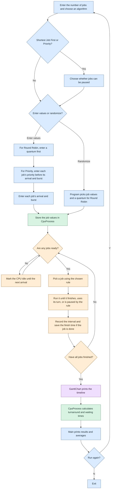

<p align="center">
  
  &nbsp;
  <a href="https://github.com/miraflowwer"></a>
  &nbsp;
  
</p>

# CPU Scheduling Simulator

Which job gets the CPU next? Run this Java console program to compare six schedules for the same jobs. Read a Gantt chart to see when each job runs and how long it waits.

<div align="center">
<table align="center">
  <tr><th>Start here</th><th>What you can do</th></tr>
  <tr><td><a href="TUTORIAL.md">Learn CPU scheduling</a></td><td>Compare six schedules and check your answer.</td></tr>
  <tr><td><a href="BRIEF.md">Explore the Java code</a></td><td>Follow one run from the menu to the results.</td></tr>
  <tr><td><a href="CPUScheduling_Larano_Froilan.pdf">View the activity PDF</a></td><td>Read the code screenshots and sample output.</td></tr>
  <tr><td><a href="#run-the-program">Run the program</a></td><td>Build the project and enter your own jobs.</td></tr>
</table>
</div>

## Video lessons

Select a preview to open the lesson on YouTube.

<p align="center"><a href="https://www.youtube.com/watch?v=VSMAjMfJ6KQ"><br>First Come First Serve</a><br><sub>Work through jobs in arrival order.</sub><br><br></p>

<p align="center"><a href="https://www.youtube.com/watch?v=t0g9b3SJECg"><br>Shortest Job First</a><br><sub>Pick the ready job with the shortest burst.</sub><br><br></p>

<p align="center"><a href="https://www.youtube.com/watch?v=lpM14aWgl3Q"><br>Shortest Remaining Time</a><br><sub>See when a shorter job can take over.</sub><br><br></p>

<p align="center"><a href="https://www.youtube.com/watch?v=YzBBJYfwdi8"><br>Round Robin</a><br><sub>Give each job a turn with a fixed time limit.</sub><br><br></p>

<p align="center"><a href="https://www.youtube.com/watch?v=gHKSmz-W0x0"><br>Priority (non-preemptive)</a><br><sub>Pick by priority when the running job finishes.</sub><br><br></p>

<p align="center"><a href="https://www.youtube.com/watch?v=A860nFJ0FsA"><br>Priority (preemptive)</a><br><sub>See when a higher-priority job can take over.</sub><br><br></p>

## From your choices to the results

The default chart uses boxes. Add `--text-chart` after `Main` to show one time interval per line.



**Class legend** · 🔵 `Main` reads input and shows results · 🟢 `CpuProcess` stores job data and calculates times · 🟠 `CpuScheduler` picks and runs jobs · 🟣 `GanttChart` shows the timeline.

## See how to code the algorithms

- **FCFS, SJF, and Round Robin.** Read how the program picks the next job, sorts jobs by length, and uses a queue for turns. [OSTEP scheduler source in Python](https://github.com/remzi-arpacidusseau/ostep-homework/blob/master/cpu-sched/scheduler.py)
- **All six modes in Java.** Follow the methods in this project. [Source guide](BRIEF.md)

## Run the program

Install [JDK 26](https://adoptium.net/) and [Apache Maven](https://maven.apache.org/install.html) 3.9 or later. The JDK is the tool that builds and runs Java programs. Maven builds this project. Run `java -version` and `mvn -version` to check your setup. The Maven output should show Java 26. A newer JDK also works if it can build for Java 26.

### Build and start the simulator

Open a terminal. You need access to this private repository to clone it. If you have a ZIP copy, unzip it, open a terminal in the folder with `pom.xml`, and start at step 3.

1. **Copy the project to your computer.**

   ```sh
   git clone https://github.com/miraflowwer/cpu-scheduler.git
   ```

2. **Open the project folder in the terminal.**

   ```sh
   cd cpu-scheduler
   ```

3. **Build the Java code.**

   ```sh
   mvn compile
   ```

4. **Start the program.**

   ```sh
   java -cp target/classes com.mycompany.cpuschedulerport.Main
   ```

---

Developed by [REQUEJO, Froilan B.](https://www.facebook.com/froilan.requejo) and [LARAÑO, Gabriel Ardee R.](https://www.facebook.com/ardeesiopaoenthusiast/) for Fundamentals of Programming.
