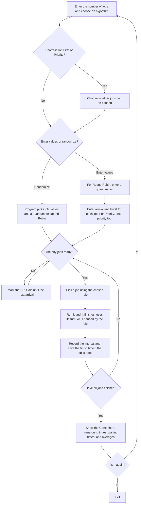

<p align="center">
  
  &nbsp; Developed by &nbsp;
  <a href="https://github.com/miraflowwer"></a>
</p>

# CPU Scheduling Simulator

Which job gets the CPU next? Run this Java console program to compare six schedules for the same jobs. Read a Gantt chart to see when each job runs and how long it waits.

| Start here | What you can do |
| --- | --- |
| [Learn CPU scheduling](docs/TUTORIAL.md) | Try three jobs, compare six schedules, and check your answer. |
| [Explore the Java code](docs/BRIEF.md) | Follow one run from the menu to the results. |
| [View the activity PDF](docs/CPUScheduling_Larano_Froilan.pdf) | Read the code screenshots and see sample output. |
| [Run the program](#run-the-program) | Build the project and enter your own jobs. |

## Video lessons

Select a preview to open the lesson on YouTube.

<p align="center"><a href="https://www.youtube.com/watch?v=VSMAjMfJ6KQ"><br>First Come First Serve</a></p>

<p align="center"><a href="https://www.youtube.com/watch?v=t0g9b3SJECg"><br>Shortest Job First</a></p>

<p align="center"><a href="https://www.youtube.com/watch?v=lpM14aWgl3Q"><br>Shortest Remaining Time</a></p>

<p align="center"><a href="https://www.youtube.com/watch?v=YzBBJYfwdi8"><br>Round Robin</a></p>

<p align="center"><a href="https://www.youtube.com/watch?v=gHKSmz-W0x0"><br>Priority (non-preemptive)</a></p>

<p align="center"><a href="https://www.youtube.com/watch?v=A860nFJ0FsA"><br>Priority (preemptive)</a></p>

## Run the program

Install [JDK 26](https://adoptium.net/) and [Apache Maven](https://maven.apache.org/install.html) 3.9 or later. The JDK is the tool that builds and runs Java programs. Maven builds this project. Run `java -version` and `mvn -version` to check your setup. The Maven output should show Java 26. A newer JDK also works if it can build for Java 26.

### Build and start the simulator

Open a terminal. You need access to this private repository to clone it. If you have a ZIP copy, unzip it, open a terminal in the folder with `pom.xml`, and start at step 3.

1. **Copy the project to your computer.**

   ```sh
   git clone https://github.com/miraflowwer/cpu-scheduler.git
   ```

2. **Open the project folder in the terminal.**

   ```sh
   cd cpu-scheduler
   ```

3. **Build the Java code.**

   ```sh
   mvn compile
   ```

4. **Start the program.**

   ```sh
   java -cp target/classes com.mycompany.cpuschedulerport.Main
   ```

### From your choices to the results

The default chart uses boxes. Add `--text-chart` after `Main` to show one time interval per line.



Developed by REQUEJO, Froilan B. and LARAÑO, Gabriel Ardee R. for Fundamentals of Programming.
