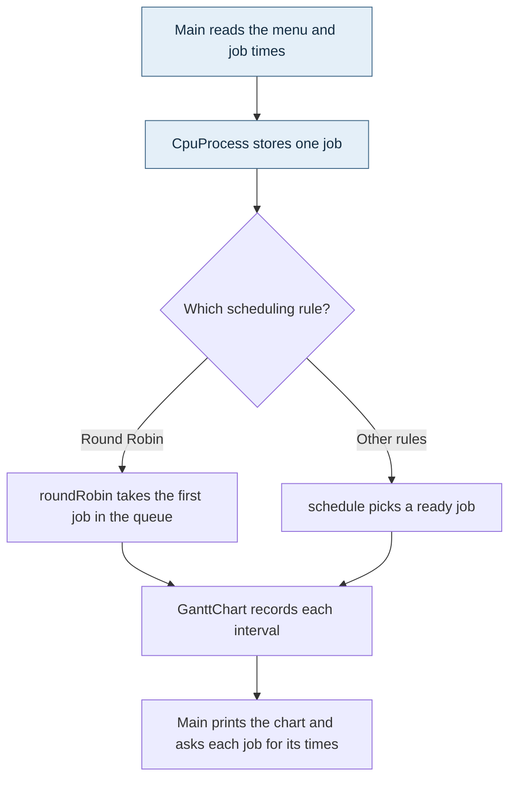

# How the Java code works

[Home](../README.md) · [Tutorial](TUTORIAL.md) · [Source guide](BRIEF.md) · [Run the program](../README.md#run-the-program)

## Follow one run

| Java file | Where to start |
| --- | --- |
| [`Main.java`](../src/main/java/com/mycompany/cpuschedulerport/Main.java) | Start at `main()`. It reads your choices, creates the jobs, calls the scheduler, and prints the results. |
| [`CpuProcess.java`](../src/main/java/com/mycompany/cpuschedulerport/CpuProcess.java) | See what the program stores for each job. Read `turnaround()` and `waiting()` to find the two formulas. |
| [`CpuScheduler.java`](../src/main/java/com/mycompany/cpuschedulerport/CpuScheduler.java) | Read `schedule()` to see how the program picks a ready job or waits for the next arrival. Then read `roundRobin()`. It uses an `ArrayDeque`, a Java queue that lets the program take a job from the front and add it to the back. |
| [`GanttChart.java`](../src/main/java/com/mycompany/cpuschedulerport/GanttChart.java) | Read `add()` to see how the chart stores each turn's end time. A turn begins where the last one ends. The chart shows each Round Robin turn on its own. |

## Trace P2 through the code

In the tutorial's SRT run, P2 arrives at 1 ms. The scheduler compares its 3 ms burst with P1's 5 ms left. At 2 ms, P3 takes over. P2 runs again from 3 to 5 ms. The chart stores both P2 intervals. Its last end time, 5 ms, becomes P2's completion time.

[Open the interactive source map](source-map.html) on GitHub to download it. Open the downloaded HTML file in a browser and select a class to see its role. The file works offline.

[See the source screenshots (PDF)](CPU_Scheduling_Simulator.pdf)
